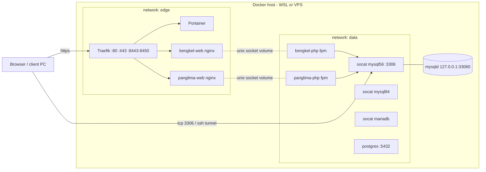

# Architecture

## Rules the layout follows

* **One compose file per stack, no `-dev/-prod/-ip` copies.** Environment = the stack's `.env` (`.env.dev.example` / `.env.prod.example` are the starting points).
* **Absolute `${APP_ROOT:-/app}` paths only.** Relative bind paths break when a stack is pasted into Portainer.
* **Project name = stack name** (`name:` in each file). Portainer, CLI and `docker compose ls` all agree.
* **No hard-coded container names for apps** (`<app>-php-1`, `<app>-web-1`); use `platform exec <app> php ...`. Infrastructure containers (traefik, portainer, mysql56-server ...) keep fixed names.
* **web and php talk over a unix socket** on a tmpfs volume (as before), so they need no shared network.
* **Only web containers join `edge`; only php containers and databases join `data`.**

## Routing model (per app, three routers in the same file)

| Mode | Variables | Entrypoint | Certificate |
|---|---|---|---|
| dev | `APP_HOST_DEV=bengkel.mysite.test` | `websecure` :443 | default store cert = mkcert wildcard |
| domain | `APP_HOST_PROD`, `APP_HOST_PROD_ALT`, `ACME_RESOLVER=le` | `websecure` :443 | Let's Encrypt (http-01) |
| IP + port | `APP_IP_HOST=<ip>`, `APP_IP_EP=ip-8444` | `ip-8444` :8444 | default store cert (private CA, see production.md) |

A mode that is not configured keeps its rule on `disabled.invalid`, which never matches and never triggers an ACME request.

## What was fixed / changed from the previous layout

| Before | Now |
|---|---|
| 3 compose files per app/stack (dev, prod, ip), copies drift | 1 file + env |
| one flat `shared-db-network` for everything | `edge` + `data` |
| a new IP port = edit Traefik compose in two places | pool `ip-8443 ... ip-8450` pre-declared; an app just picks one |
| prod labels such as ``Host(`://yourfirm.com`)`` (invalid) | host comes from `APP_HOST_PROD` |
| IP stack default cert used `keyFile: server-ip.pem` (the cert, not the key) | one `default.pem` / `default-key.pem` pair |
| mkcert ran on every start | runs only when missing, names changed, or older than ~700 days |
| Traefik dashboard `api.insecure` published on `0.0.0.0:8082` | loopback only (`127.0.0.1:8080`; SSH tunnel on a VPS) |
| empty MySQL root password in the prod compose | password from `.env`; empty only if you opt in |
| nginx `set_real_ip_from 172.18.0.0/16` tied to a fixed subnet | all private ranges, no fixed subnet needed |
| `HostRegexp(`<ip>`)` for IP routing | `Host(`<ip>`)` |
| one Dockerfile per PHP version (copy/paste) | one parameterised Dockerfile, `local/php:<version>` |
| `version: '3.8'` (obsolete in Compose v2) | removed |
| CRLF files from Windows break `.cnf`/shell inside Linux containers | `.gitattributes` forces LF |
| Docker socket mounted into Traefik | unchanged (`:ro`). See "Hardening" below |

## Hardening you may want later
* Put `tecnativa/docker-socket-proxy` between Traefik and the Docker socket (Traefik only needs read access to containers).
* Create one DB user per app instead of using `root` (see databases.md).
* Pin image tags (`TRAEFIK_TAG`, `PORTAINER_TAG`, DB tags are variables already) after you settle on versions.
